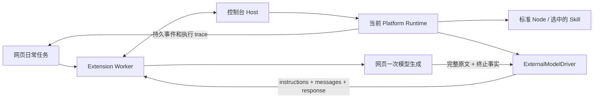

# 浏览器日常任务与 ScriptAct Bridge

Platform 负责可复用桥合同和当前 Runtime 执行链；Extension 负责无界面 CLI Host、浏览器传输、日常任务 UI 与权限决策。具体产品使用和 wire 消息见 [Extension Bridge](../../../VelarOS-Extension/docs/scriptact-platform-bridge.md)。

## 当前链路

用户运行 `node bin/extension-host.mjs serve`，完成扩展 popup 配对后即建立日常会话。Host 使用当前 `createRuntime` 和 `createNodeExecutionEnvironment`，模型供给来自网页。ScriptAct 的语法、接收、预检、后续请求、效果和完成判定沿用现行 Runtime。

## 公开合同

桥单元位于 `packages/velaros/act/bridge`，公开入口为 `@velaros-ai/velaros/act/bridge` 与 `@velaros-ai/velaros/act/bridge/contracts`。

| 公开面                                 | 原因与影响                                                             |
| -------------------------------------- | ---------------------------------------------------------------------- |
| createExternalModelDriver              | 将固定网页通道接到现有 ModelDriver；Runtime 的任务与上下文职责保持同源 |
| ExternalModelDriverApi.deliver / close | 以 requestId 和 lease 受理完整响应，断开及取消撤销等待                 |
| ExternalModelDriverOptions             | 产品注入发送、取消、身份生成、容量和可选估算                           |
| ExternalModelRequest / Reply           | 便携完整请求和原子回复；text 或当前 JSON schema，不建立额外工具循环    |
| ScriptActBridge 常量                   | 单一 wire 身份、合同修订、端口与容量限制，浏览器生成物直接消费         |
| scriptActBridgeProtocol.parse          | 严格信封核验；领域 payload 与访问策略由产品 Host 核对                  |

单元按 contract、types、impl、utils 治理并登记 layers、browser-safe contracts、模块 README、不变量和验收。既有 ScriptAct 模型能力声明、Runtime、renderer 与执行合同沿用公开接口。

## 模型请求与受理

`ModelDriver.stream` 没有 sessionId 参数，产品为每个日常会话创建固定网页路由的驱动。每次派发生成独立 requestId 与 lease，先登记等待再发送。晚到、重复或错误租约不受理；AbortSignal、超时和通道关闭撤销等待，并通知供应商适配器取消具体请求。

文字编码使用 Kernel 的 `modelRequestEncoder.messages` 和 `response`，包含 instructions、完整消息历史及响应合同。图像按真实消息顺序抽取为附件，正文保留对应索引。默认输入估算基于同一编码的 UTF-8 字节与图像预留，是保守估算，不记录成供应商实测用量。网页直接发送这一正文；供应商隐式系统文本属于页面适配边界，未报告的 usage 保持未知。

驱动以 `nativeTools:false` 进入当前文本 ScriptAct 链。完整正文和有效的供应商终止事实同时到达才输出 text / finish；JSON 响应另外调用正式 schema 解码。供应商流的 EOF 不构成完整结束。回复上限与 wire 字节上限来自同一个常量表。

## 产品 Host 的责任

Extension CLI 监听 loopback，管理短期配对、设备令牌、进程 epoch、当前页面通道、提交收据、事件恢复、Skill 租约与进程回收。标准 Runtime 不把 inputId 当成去重键，因此 Host 在派发前持久化 submitId 的收据。

日常环境默认执行目录为用户家目录，使用标准 Node 系统环境，Skill 按用户选择加载，看图实现按首次操作加载。当前轻量入口使用空 residentModules 并控制额外后台服务。状态目录独立持久化，同一目录通过 SQLite 锁排他运行。

标准档将本地源码和 Skill 管理权限请求转换成真实 session confirmation，扩展自有批准卡回答具体 runId / id；完全访问由 Host 自动批准。审批属于产品授权策略，本地执行使用启动用户的系统权限。

网页展示使用公开 renderer 的 `createActEventProjector`，与 Desktop 的已接受消息和运行状态投影一致。代码卡片与最终结果来自 `session.trace` 的执行事实；预览和推测不能充当成功回执。

## 体积与系统支持

CLI 复用系统 Node.js 24+，发布目录含运行闭包与标准基础包。依赖单份存储，由启动壳按系统重建目录链接：Unix 相对目录链接，Windows junction。浏览器 ZIP 与 Host 归档分别发布。扩展内只有浏览器资产。

包采集只从公开 exports 加载当前实现和按需入口；分发验证实际运行裁剪目录里的 Runtime，执行文件写入并看图。开发目录可以消费同级构建产物，发布目录必须独立通过同样的执行验证。

## 当前验证与承诺

桥验收覆盖撤销、错误租约、晚到回复、原文完整交付与 JSON schema。Host 验收覆盖连接即日常环境、Origin、页面归属、标准批准前无效果、有效批准后真实写入、重复提交去重、过期批准与完全访问。网页另用受控供应商和 Chromium 验证 UI / Worker / Host / Platform 的实际链路。

三系统 CI 工作流以包含当前桥入口的 Platform ref 为输入；本地 macOS 结果和跨系统矩阵结果分别记录。供应商在线登录与最新 ChatGPT 页面仍需真机在线验收；输入定位与扩展固定入口的受控变化测试不替代这一证据。
