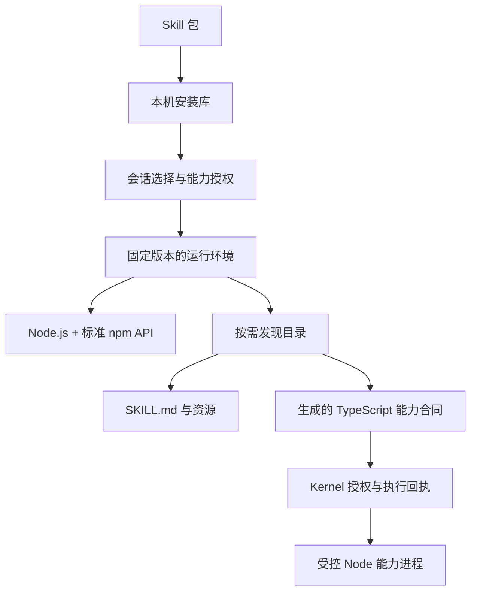

# Skill 与标准 Node 运行环境

Skill 是可以安装、升级和卸载的包。Agent 始终在标准 Node.js 中执行；Skill 按需要贡献标准 npm 包、说明、资源和外部能力。



## 包格式

普通 npm 元数据、版本、依赖和 Node 版本约束沿用 package.json。`agentSkill` 只声明贡献：

```json
{
  "name": "release-review",
  "version": "1.0.0",
  "description": "核对项目发布准备情况",
  "engines": { "node": ">=22.15.0" },
  "dependencies": { "semver": "7.8.5" },
  "agentSkill": {
    "instructions": "SKILL.md",
    "packages": ["semver"],
    "capabilities": [
      { "module": "skill:release-review", "entry": "provider.mjs", "contract": "provider.d.ts" }
    ]
  }
}
```

三个贡献字段都可省略，但至少提供一类。`packages` 只列公开给 Agent 的裸包名；其余依赖留在 Skill 内部。包可以公开自己，也可以公开 dependencies 的直接依赖。标准包保持原本的 API、exports 和子路径。

纯说明目录只需要带 name、description frontmatter 的 SKILL.md。安装时在暂存副本生成清单，源目录保持原样。说明、脚本和资源路径均相对 Skill 安装目录。

## 使用与发现

宿主可通过 `createSkillSession({ registry, selection })` 启用按需会话：全部已安装 Skill 的用途进入发现目录，selection 只预加载工作区默认项与手动选择。模型调用 `load` 或对应能力时才装配所需依赖；并发重复加载合并，每次程序保持自己的固定快照，新增 npm 包从下一次执行使用。session 同时传给能力装配与管理上下文，并提供 Node 的 acquireRuntime。全部前台与后台执行收束后才 release。以下固定选择模式仍供需要显式范围的宿主使用。

设置页管理本机库：从文件夹导入、查看包的说明与贡献、升级和删除。聊天框「+」沿用 Skill 选择菜单和可移除标签，按会话选择所需包；发送和排队保存确切安装代次及声明能力授权。升级后重新选择，已有队列不会自动获得新能力。默认未选择 Skill 的会话使用基础环境。

模型从 `velaros:skills` 按需 import：guide 查询随包开发规范、管理文档和可写入的示例文件；list 查询安装与本轮可用状态；load 读取本轮所选 Skill 的说明；validate 静态校验工作目录中的包；install、remove 经宿主确认修改本机库。普通目录创建和 npm 使用依然由 Node 完成。沙箱限制管理操作的来源目录，真实符号链接也遵循同一边界。

安装默认关闭依赖生命周期脚本，需要时明确申请；进行中的安装可取消。注册处成功发布后通知订阅者，设置页与聊天候选列表直接刷新。说明正文和开发规范只在查询时返回。

每次执行提供 `$VELAROS_HOST_DIR/index.json`：

- `environment`：本次固定的环境身份。
- `packages`：基础包与 Skill 公开包的实际版本、解析根、原包目录 `root`、清单 `packageJson` 以及包自带的 `readme` 入口。
- `skills`：用途、安装目录、说明路径及当前执行可用的能力。
- `capabilities`：已授权模块及生成的合同、客户端路径。

发现目录通过普通文件读取；说明正文按任务需要读取。标准 npm 包保留原始 README、package.json、类型声明与发布代码，模型可按实际安装版本核对 API、exports、参数和示例。原包的类型入口从 package.json 的 types、typings 或 exports 获取，资源也随应用分发。标准库与 npm API 无额外教程。增加 Skill 数量不会增加常驻系统提示中的说明正文。

工作区已有依赖优先；缺失包再解析本次环境。ESM、CJS、createRequire、保存脚本和继承执行环境的 Node 子进程采用相同规则。损坏的工作区依赖保留原本错误。不同会话可以选择各自的依赖版本；同次选择的公开包名冲突在环境组装时明确失败；同版本且内容一致的贡献可以复用。

## 外部能力

外部能力使用 `skill:<名称>`。provider.d.ts 提供自包含的具名函数声明，每个函数接受零个参数或一个 JSON 参数，并写明 `@OperationEffect none` 或 `write`。只在执行入口使用的操作标记 `@OperationModes execute`。合同、参数校验与发现内容由同一 TypeScript 编译器派生。

包源码只在受控 Node 子进程中运行，继承当前工作区的进程权限、时限与取消。能力调用经过 Kernel；本次租约决定能力授权，每次派发重新核对安装代次。卸载或升级会拒绝旧代次的后续调用。已经派发的调用按原执行时限和取消链路收束。

标准 Node 文件、进程、网络操作由操作系统执行边界管理。Skill 能力授权控制宿主能力桥；普通 npm 代码使用当前 Node 进程本身具备的权限。

## 生命周期与存储

产品基础依赖由应用随包分发并校验。用户安装位于应用数据根 `skills/`，包括暂存区、不可变安装代次、环境快照和租约。依赖准备使用应用自带 Node 与 npm：已有锁文件使用 npm ci，否则 npm install 生成锁文件；发布不依赖系统 PATH 中的 Node 或 npm。

只有依赖准备、入口合同和内容散列全部通过后，才在跨进程锁内原子切换索引。失败或取消保留之前的有效安装。租约固定依赖版本和能力集合；Desktop 主聊天按当前发送的选择取得租约；安装只加入本机库，聊天选择作用于后续发送。后台任务继续持有依赖租约，确认退出之后才允许回收。启动恢复会清理已经退出的进程留下的租约。

索引 v2 保存安装事实；读取 v1 时保留安装内容并迁移旧字段，会话始终依据显式选择加载。

## 示例与验证

`examples/skills/guided-review` 是纯说明目录；`semver-tools` 只安装标准 npm 包；`team-directory` 组合说明、资源和外部能力。后者的 service.json 由包作者填写实际组织目录端点，服务按 `q` 查询并返回 `[{"name":"…","email":"…"}]`。

平台验收位于 `packages/velaros/skills/spec/acceptance.test.ts`。Desktop 另有真实受限宿主的 npm 安装测试、后台任务租约测试、可信 IPC 与取消测试，以及空 PATH 的运行资源和 ASAR 执行测试。
