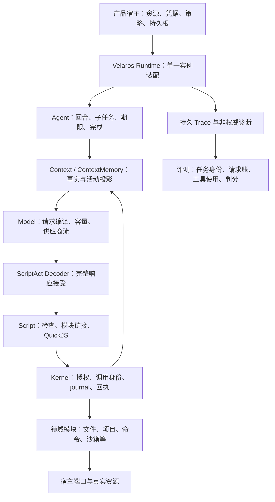

# ScriptAct 框架根基审核

日期：2026-09-30。轮次：52。本文保留审核时的证据与判断；当前修复及验收状态见 [根基审核修复总报告](scriptact-foundation-fixes.md)。

审核基线为 `VelarOS-Platform` 的 `main`，HEAD `86bd823ca4dfe4f2db0859ab75ad851e46ee03bb`，包含审核开始时已有的未提交修改。此前修复并未仅按 HEAD 审查。本轮只增加报告和离线证据，产品修改另行实施。

## 1. 总体判断

现有架构的主要职责分配可以保留：Agent 管运行循环，Script 管程序检查与隔离，Kernel 管唯一能力派发和回执，Context 管任务与证据，Model 管真实供应商请求，领域模块管资源规则，产品宿主管原生资源与策略。没有发现需要推翻整个框架或放弃 ScriptAct 的证据。

但现在还不能把这套实现视为可靠的批量优化基线。已经复现的缺口会导致合法程序静默算错、活动上下文被回收、并发修改被覆盖、提交事实被错误处理，以及并发评测重复归账。这些错误发生在模型推理之外，继续花钱跑题会混淆模型能力、工具质量和框架缺陷。

需要调整的重点是六类合同：**语言执行语义、持久对象引用、资源句柄授权、取消与提交生命周期、当前意图状态、长程数据访问与计量身份**。它们分别归原有 owner，不建议新增一套绕开 Kernel 的执行器、在提示词里弥补实现错误，或把领域事务塞进通用 Core。

本报告区分确定缺陷、设计风险和待验证范围。确定缺陷表示本地源码或可控探针已给出反例；设计风险表示机制缺口成立，但没有声称真实模型或所有产品宿主已经出现对应后果。

## 2. 审核分工与实际链路

三个子 agent 分别负责执行内核、上下文与模型、领域工具；主 agent 负责跨层装配、Desktop 消费路径抽样、架构门禁、计量反例和结论复核。执行组随后独立复核了工具组的权限与并发写入结论。

图中是职责和数据流，不能把每根箭头理解为包的静态 import。搜索、整理和子 agent 复用同一运行主链，各自受能力与预算范围约束。

| 层/模块 | 覆盖深度 | 结论 |
|---|---|---|
| Core、包拓扑、宿主边界 | 当前合同、登记表、10 项门禁；没有遍历所有原语实现 | 保留；当前源码 owner 在 Platform，产品壳负责装配 |
| Kernel / Agent / Script | 主调用链、取消、回执、效果、QuickJS、模块重写；当前源码探针 | 重点处理 F01、F05、F10 |
| Context / Runtime 状态 | 原文、投递租约、段/卷、GC、CAS、恢复、整理；真实 SQLite 探针 | 重点处理 F02、F08、F09 |
| Model | 编译器、缓存、动态能力、usage、预算；本地合同测试 | 请求编译方向保留，补 F13 的能力与估价来源 |
| Act system/search/agents | 模块发现、作用域、材料、共享状态、子任务预算与取消 | 主链复用合理；跟随状态与生命周期合同修复 |
| project / files / sandbox / shell | 合同与关键实现深查，文件与沙箱真实本地复现 | F03–F07；Shell 审批和 OS 约束需要继续分开表达 |
| office / computer | 合同、提交与取消关键路径，受控探针 | F05、F07；未调用真实桌面输入或外部办公进程 |
| browser / web / images / memory / sessions | requires、生成声明、模板及关键路径抽样 | 保留模块分工；不能据此宣称完整端到端通过 |
| Desktop 集成 | 只读抽样 WorkspaceSession 的实际模块装配与授权 | 用于限定缺陷适用面，未运行 Desktop 全套集成 |
| 评测及工具计量 | 原有方案、请求归属、trace、指标代码、重叠任务反例 | F11、F12 必须进入批量评测准入条件 |

完整子报告与探针位于 `.velaros-workspace/bench/foundation-audit-52/{execution,context,modules,root}/`。本轮没有运行真实模型基准、联网工具、远程部署或全 OS 安全认证。

## 3. 优先级总表

P1 表示应在对应能力成为正式评测/长期运行基线前处理；P2 表示局部合同或计量缺口。表中的“风险”不能与已发生的数据损坏混为一谈。

| ID | 级别/证据 | 问题 | 处理方式 |
|---|---|---|---|
| F01 | P1，确定 | 接受 ES 模块程序却改变 live binding 和 import 执行顺序 | 重设计模块执行语义，或预检拒绝不支持的子集 |
| F02 | P1，确定 | GC 不识别段底座和冻结历史的间接强引用 | 重设计对象引用/收集合同 |
| F03 | P1，条件明确的确定缺陷 | undo / sandbox 句柄未完整绑定当前资源作用域 | 统一身份合同，领域端口逐次核权 |
| F04 | P1，确定 | files 大文件因撤销预算而失去提交前版本保护 | 分离并发前提与撤销正文保留 |
| F05 | P1，挂起和取消后副作用已复现 | 不合作能力拖住停机；部分领域准备后未复查取消 | 明确取消、物理停止、提交、迟到结算合同 |
| F06 | P1，确定 | project 提交后 hook 失败被当成未提交，原错误与变更回执丢失 | 分离事务提交与后处理结果 |
| F07 | P1，确定 | office 的 overwrite:false 只在准备时检查 | 将覆盖策略带到最终原子写入 |
| F08 | P1，确定复杂度缺陷 | 当前段投递虽小，每帧仍查询全部历史 | 活动投影索引与范围查询 |
| F09 | P1，设计风险 | 历史约束汇总缺少当前有效/撤销/取代状态 | 增加有来源的当前意图账本 |
| F10 | P2，确定 | 执行模式漏核，部分生成模型文档的批次/审批承诺失真 | 补运行一致性与行为合同验收 |
| F11 | P1，确定，开并发后触发 | 评测按时间窗归属请求，重叠任务重复记账 | 全链路按任务/尝试/请求身份关联 |
| F12 | P2，已确认功能缺口 | 工具总数已有，模块/工具明细与完整生命周期汇总尚未实现 | 从权威回执建分层统计 |
| F13 | P2，合同风险及估价缺口 | 模型容量猜测缺来源；部分费用可被当成完整总价 | 明确能力来源、未知值、估价完整度 |

### F01：语言语义必须与模型收到的合同一致

程序被定义为 JavaScript ES 模块，但当前实现把具名 import 改成普通对象解构，导出在函数尾赋值，静态 import 在正文所在位置执行。

两个当前源码 QuickJS 探针都检查成功且无诊断：库导出 `let n=0` 和 `bump()`，调用 bump 后读取 n，Script 得到 0、原生 ESM 得到 1；正文先赋值再出现静态 import，Script 与原生 ESM 的最终值分别为 1 和 2。纯函数/常量辅助模块通常不受这两个例子影响；没有证据显示隔离逃逸。

证据：[程序合同](../../packages/script/src/types/script.ts#L31)、[模块改写](../../packages/script/src/utils/module-form.ts#L85)、[审核时的库执行](https://github.com/VelarOS-AI/VelarOS-Platform/blob/86bd823ca4dfe4f2db0859ab75ad851e46ee03bb/packages/script/src/utils/worker-program.ts#L189)。探针及 Node 对照在 `execution/minimal-repro.ts`、`repro-results.jsonl`、`native-esm-results.jsonl`。

建议先评估 QuickJS 原生模块链接，通过受控的合成模块继续接入原能力桥。若确实只支持子集，应在合同与检查器同时定义并拒绝无法保证的语义。验收包含 live binding、静态依赖顺序、re-export、namespace、顶层 await、循环依赖的明确支持/拒绝矩阵；支持项与原生 JS 做差分测试。

### F02：持久化正文的存活性不能靠 JSON 内嵌 ID 暗示

ContextMemory 单独保存底座正文，RecentContext 单独保存冻结正文，随后把 objectId 嵌进段状态。GC 只保护 `context_records.object_id` 直接引用的对象。显式回收超过宽限期的对象时，活动段正文被判成孤儿。

真实 SQLite 探针中，2 个仍被活动段使用的对象被删除，下一次组帧报 `NOT_FOUND / 段底座正文缺失`。GC 默认预演、版本检查和一小时宽限期均存在；宿主没有实际执行 collect 时，不会仅因本缺口自动发生删除。

证据：[底座保存](../../packages/velaros/act/runtime/impl/ContextMemory.ts#L1192)、[冻结历史](../../packages/velaros/act/runtime/impl/RecentContext.ts#L314)、[回收判据](../../packages/context/src/impl/LocalContextStorage.ts#L409)。

建议选择显式强引用边，或让这些正文拥有标准 ContextRecord，由上层使用 ContextRef；记录发布与引用边必须原子提交。所有后端遵守同一存活性合同。验收要覆盖 GC 后重开、逐字前缀恢复、失败 CAS 的孤儿回收、并发写入和已有数据的明确处理，不能只延长宽限期。

### F03：资源 ID 必须携带授权范围

两个独立入口存在同类缺口：

- files 的进程全局撤销账按 changeId 取出绝对 target，undo 不经过当前 `locate`。受限端口明确拒绝旧路径时，探针的作用域检查次数仍为 0，真实文件被还原。
- project sandbox 只在 create/source 解析时约束项目，后续 diff/apply/run/discard 直接转发 ID。共享宿主下，B 项目拒绝 A 的 source，却能用 A 的有效 sandbox ID 将改动写回 A。

这是**持有有效旧 ID，且当前范围已不同**时的缺陷，不是无须身份即可操作任意资源。当前 Desktop 抽样中 files 只挂在系统会话，项目会话使用 project 内核；也没有在该文件发现演练 sandbox 挂载。因此本报告没有证明当前 Desktop 项目隔离已被这两条路径穿透。Platform 公共受限端口和多项目宿主的合同仍不成立。每项目创建一个默认 sandbox host 也不足以证明隔离，因为持久 manifest/默认目录可以共享。

证据：undo（Git 源码 `d3b6c5cd:packages/velaros/files/impl/FileOperations.ts#L249`）、全局账（Git 源码 `d3b6c5cd:packages/velaros/files/impl/FileOperations.ts#L389`）、[sandbox 项目端口](../../packages/velaros/project/impl/operations/ProjectCapabilityPorts.ts#L98)、Desktop 装配（`VelarOS-Desktop/src/main/application/runtime/WorkspaceSession.ts#L195`）。执行组已独立复核，见 `execution/cross-review.md`。

建议资源句柄统一绑定 scope/resource identity/generation；每次恢复、应用和撤销验证当前授权与规范路径。领域 owner 持有资源身份，宿主提供策略，Kernel 保留调用身份。测试交叉两项目、授权收窄、重启、符号链接变化和合法同范围恢复；不要靠增加随机 ID 长度处理授权问题。

### F04：撤销保留大小不能决定并发正确性

files 独立于 project 的事务引擎。大于 2 MiB 的旧正文不留在 undo 账中，`writeOfPlan` 因而不传 expected；准备结束到实际落盘之间若有外部修改，会被静默覆盖。小文件对照会传 expected 并正确拒绝。探针分别得到 `external-change` 保留和被替换为 `planned` 的结果。

证据：保留条件（Git 源码 `d3b6c5cd:packages/velaros/files/utils/plan.ts#L177`）、提交前提（Git 源码 `d3b6c5cd:packages/velaros/files/utils/batch.ts#L79`）。已有的早期指纹检查不能替代提交边界的校验；当前单 Runtime 写闸门也管不到外部编辑器和其他 Runtime。

建议所有大小都保留版本/摘要前提，撤销正文另按保留预算处理；提交端落实冲突检测与原子替换，并如实限定对不合作外部进程的保证。验收围绕阈值上下、编码/换行、创建/删除、跨实例和准备后外部修改，不能只修一个大文件样例。

### F05：取消、停止和提交是三个不同事实

执行内核方面，prepare/授权/handler 直接 await；prepare 甚至没有 signal 合同。探针让 prepare 或 run 等待不合作 Promise，取消后 invoke 和 dispose 均持续等待。write handler 还可能持有 ComposedRuntime 的效果闸门，阻塞冲突写入和停机。默认 QuickJS 的 CPU 中断与子进程回收已有保护，但它们不能终止宿主中的任意异步工作。

领域方面，files.edit 在异步定位后、sandbox.apply 在 diff 后、computer.typeText 在 ensureAvailable 后，已发生取消仍进入副作用。探针使用可控端口，不操作真实桌面。这里能在提交前合作停止，应补复查和端口级 signal，而不是把它们与不可中断的已提交操作混淆。

证据：[Kernel prepare](../../packages/kernel/src/impl/runtime/OperationRuntime.ts#L410)、[dispose](../../packages/kernel/src/impl/runtime/OperationRuntime.ts#L554)、[写闸门](../../packages/velaros/act/runtime/impl/ComposedRuntime.ts#L637)、files 提交（Git 源码 `d3b6c5cd:packages/velaros/files/impl/FileOperations.ts#L229`）。

建议定义：可合作取消、可物理终止、无法确认停止的执行类型；区分 prepared/started/committed/settled，并传播 deadline/signal。无法确认停止时保持在途/unknown 事实、隔离冲突资源，并让关闭流程在有界时间报告未收束任务。**不得简单 Promise.race 超时后释放写锁。** 已真实提交的迟到成功仍应记录 committed，不能伪装成取消且无效果。

验收使用不合作 prepare/授权/handler、排队取消、准备后取消、已提交后取消、迟到回执与重启，核对副作用次数、资源锁和状态都一致。

### F06：项目提交后的失败需要保留已提交事实

合法的 AfterApplyEdit hook 抛错时，文件已经写入。上层 `commitProjectEdit` 的 catch 却无条件 discardTransaction，随后抛出“只能丢弃尚未应用的事务”，遮蔽最初错误，并未返回 changeRef。真实探针中 note.txt 已从 before 变成 after。

证据：[提交及 hook](../../packages/velaros/project/impl/kernel/LocalProjectKernel.ts#L1044)、[统一 catch](../../packages/velaros/project/utils/agent/edit-commit.ts#L58)。Kernel 会保守表达未知效果，这避免凭空声称没有写入，但领域层已有的精确提交事实仍然丢失。

建议把准备失败、提交失败、提交成功后的 hook/展示失败分开；先持久化 transactionId、变更身份与提交结果，再执行后处理。后处理失败保留诊断和已提交回执。验收 hook 抛错、回执展示失败、持久化失败与恢复，确保不会重放已经生效的修改。

### F07：Office 覆盖策略必须约束最终写入

`prepareOfficeOutputPath` 检查不存在后返回 path/created，`overwrite:false` 不再保留到最终写出。准备与写出之间另一工作者创建同名文件，普通 writeFile 仍覆盖它。该反例已实际复现。

证据：[准备](../../packages/velaros/office/utils/paths.ts#L87)、同文件的 `writeOfficeFile`。现有真实路径校验会阻止静态越界；本次复现的是覆盖语义竞态，没有声称已完成符号链接竞态攻击验证。

建议最终提交使用带覆盖策略和版本前提的原子发布：不覆盖时使用独占创建/等价机制，替换已有文档时校验版本。转换临时文件与最终提交分别表达结果。验收同名并发创建、允许覆盖、追加、取消和转换后发布失败。

### F08：长程设计还缺宿主数据访问的上界

RecentContext.project 查询全部 assistant、script result 和 continuation，之后才按 segment.from 筛选；volumes/narratives 也加载历史正文。固定只投递 2 条消息，100 条历史返回 100 条记录，1000 条历史返回 1000 条记录。请求 token 有界，不能据此推出本地 CPU、内存和组帧延迟有界。

证据：[历史选择](../../packages/velaros/act/runtime/impl/RecentContext.ts#L221)、[卷查询](../../packages/velaros/act/runtime/impl/RecentContext.ts#L175)、[长期目标](../../docs/architecture/long-running-context.md#L7)。未测得真实生产延迟，结论限定为访问复杂度。

反证：appendRecord 是增量追加，全量 CAS 只 upsert changed，任务/预算还有 metadata CAS 快径。因此不是所有写入都重写整表。

建议为活动段建立范围查询和索引，维护当前卷目录/叙事/工作集投影，把全量回放留给显式审计恢复。验收固定当前工作集，在历史规模递增时核对所读行数、对象数、序列化字节、组帧时间和内存；不能只验证“不调用 load”，也不能用提高缓存命中率代替此项。

### F09：当前意图需要自己的生命周期

原始输入和历史摘要应忠实保留当时内容，但当前活动约束不能仅是历史约束字符串的并集。同任务先要求 A、随后纠正 B，探针的长期单仍列 `Use package B` 和 `Use package A`，没有哪个已经失效的结构化状态。

证据：[汇总](../../packages/velaros/act/runtime/impl/ContextMemory.ts#L1147)、[账本投影](../../packages/velaros/act/runtime/utils/segment.ts#L76)。新输入按时间排序、当前运行目标提示和 task:new 已有保护，所以不是“用户无法纠正”，也没有真实模型误遵循旧约束的结论。风险在于系统把冲突解释长期交给模型重复完成。

建议历史记录保持不可变，当前意图另以稳定 ID、来源输入、active/superseded/retracted 和版本表达；未解项与关键决定也应有承接/关闭依据。用户纠正、撤销、恢复旧要求和整理模型误抽取，均需跨封段与重启的验收。模型提取仍是不确定解释，不能获得高于原始用户输入的权限。

### F10：生成合同中的执行模式也必须被 Kernel 核验

公共 Kernel 挂载入口只比较 surface 与运行定义的 input/output/effects，遗漏 allowedModes。生成 surface 明确 execute-only，运行定义漏字段并提供 observe 时，构造与 observe 调用都成功。内建 CapabilityModules 原样透传生成 descriptor，有保护；本项影响手工/扩展模块装配。

证据：[一致性检查](../../packages/kernel/src/impl/runtime/OperationRuntime.ts#L115)、[模式检查](../../packages/kernel/src/impl/runtime/OperationRuntime.ts#L395)。建议规范化后统一比较，构造阶段拒绝差异；不用另设第二份权限名单。

同源生成还存在语义盲点：files 的 AgentView（Git 源码 `d3b6c5cd:packages/velaros/files/impl/FileOperations.ts#L94`） 概述“一次成败”，实际 LocalFilePort 逐文件提交并支持 partial；[sandbox 的 AgentView](../../packages/velaros/sandbox/impl/SandboxOperations.ts#L36) 承诺 apply 要用户点头，当前 apply 行为与产品规则是直接执行。生成器会忠实复制这些错误承诺。应在 TS 文档中准确区分批次预检、单文件原子提交和部分完成，按当前 apply 行为更新说明，再重新生成；故障注入结果必须与模型所见承诺一致。

### F11：并发前必须换掉按时间归账

当前 report.py 明确假设单任务运行，按执行开始至试验结束的时间窗筛共享请求。主 agent 构造两个重叠任务、两次总价 $3 的合成调用，report.summarize 给每个任务都分配 2 次、$3，合计变成 4 次、$6。

证据：[归属逻辑](../../scripts/agent/harbor/report.py#L92)、`root/overlap-accounting-repro.json`。这是并发扩展的确定阻断项；当前串行约束是反证，不能据此宣称历史串行账已经重复。

建议把 campaign/candidate/participant/task/attempt/session/request 身份贯通网关、容器、子请求、重试和迟到结算；身份由控制器绑定，不能靠模型提供。明细只能归属一次，未归属保持未知并阻止生成“完整成本”结论。安装检查也按本尝试身份核对，不能比较共享全局计数。

### F12：工具用量需要从权威事件建模

已有 Trace 保留 moduleId、operation、调用身份及效果；metrics 已区分 ScriptAct 底层操作与 Codex ATIF 外层调用。当前聚合主要是总工具数、失败数和 Shell 子项，尚没有用户要求的完整模块/操作汇总；RuntimeMetric 也只有 storage/effect 阶段，不能直接充当全工具计数账。

证据：[Trace 合同](../../packages/velaros/act/runtime/types/trace.ts#L34)、[现有聚合](../../scripts/agent/harbor/metrics.py#L299)、[诊断口](../../packages/velaros/act/runtime/impl/RuntimeDiagnostics.ts#L72)。

建议保留原始调用账，以稳定调用身份去重，分别统计声明/发现、脚本执行、实际底层操作；记录 queued/started/rejected/succeeded/failed/cancelled/pending、时间、重试及子会话归属。一个 execute 调五个操作，应分别计为 1 和 5。并行耗时总和与整题墙钟分列；整轮模型费用只记一次。每条记录保留原始证据位置，汇总可从明细重建。重复读取必须结合对象、范围和版本判断，不能把同名工具多次调用直接当浪费。

### F13：模型能力和费用需要显式表达证据来源

容量：未知自定义模型名称若匹配 gpt-5 前缀，会被回退为 400000；离线别名只是合成输入，不证明真实供应商容量。显式配置和动态鉴权范围目录优先，现有能力发现并非全硬编码。图片估计固定值也缺少模型/尺寸维度。

费用：Platform Model 的通用 usage 仅含总输入/输出费率；summary 对未知 cost 跳过，能返回部分已知金额却没有完整度。探针的 2 次调用合计 2200 tokens，一次 cost 0.0024、另一次 null，汇总仍是 cost 0.0024。Harbor gateway 另有缓存读写与未知请求统计，本项不表示历史 benchmark 费用因此算错。

证据：[容量回退](../../packages/model/src/utils/catalog/context-windows.ts#L24)、[费用归一与汇总](../../packages/model/src/utils/usage.ts#L58)。建议能力返回 value/source/confidence 和精确端点/模型身份；费用返回 estimated/partial/complete、定价版本和各 token 维度。未知不能伪装为零或确定能力。新评测先冻结所用模型的明确能力与价格合同。

### 其他需要明确边界的设计风险

| 风险 | 已核实的机制与现有保护 | 进一步设计/验证 |
|---|---|---|
| 项目 cwd 与命令的 OS 隔离是不同保证 | project shell 端口约束 cwd；普通 LocalShellHost 默认可为 danger-full-access，文档如实报告 enforcement:none；受限观察没有隔离后端会拒绝 | 宿主明确选择 confinement，并让模型和用户看到的范围说明一致；不能把“cwd 在项目内”当作任何命令都无法访问项目外的证据。本轮未运行各平台隔离端到端 |
| 浏览器超时释放队列但旧 action 可能继续 | browser `runWithHoldCap` 会释放槽位以避免死锁，超时本身不物理取消旧 Promise | 会话代次/目标身份应阻止旧动作恢复后污染新状态；需 Electron/CDP 假后端迟到动作验证。本轮静态发现，未复现真实浏览器交错事故 |
| 长期记忆同 ID 并行更新是最后写入获胜 | MemoryScope 读 tags 后原子替换，防半文件，但没有 revision/CAS；当前覆盖合同不承诺自动合并 | 多 agent 共享同 scope/id 时明确接受覆盖或使用 CAS/串行更新；验证 save/save 与 save/remove。当前不能按缺少合并能力宣称数据已经丢失 |

来源：Shell 默认模式（Git 源码 `d3b6c5cd:packages/velaros/shell/impl/local/LocalShellHost.ts#L149`）、[浏览器等待](../../packages/velaros/browser/utils/session.ts#L105)、[长期记忆写入](../../packages/velaros/memory/impl/MemoryScope.ts#L56)。这些风险应按实际启用的能力进入验收，不能以抽样未见异常代替证明。

## 4. 应当保留的核心设计

| 设计 | 为什么保留 | 当前边界 |
|---|---|---|
| ScriptAct 批量程序表达 + 唯一 Kernel 派发 | 支持一次请求组织多个操作，又保留统一授权与回执 | 批量预检不代表全部外部效果可原子回滚 |
| TS 操作接口生成声明、schema、发现和模板 | 减少模型面与实现面漂移 | 补齐 allowedModes 的运行期一致性检查 |
| 成败与外部效果分开 | 取消/报错不能抹去真实提交 | 领域必须尽量提供已知事实，见 F06 |
| 不可变原文、来源、版本、CAS、投递租约 | 展示压缩可以变化，证据可追溯 | 修好 GC 强引用和当前状态生命周期 |
| QuickJS 独立堆与显式能力桥 | 模型程序不直接取得 Node/宿主能力 | 补语言语义；OS 进程/资源约束仍需宿主证明 |
| 默认冲突写串行、声明资源后按冲突范围并行 | 未知资源范围采取保守调度 | 仅实例内有效，领域需处理外部修改与跨实例竞争 |
| 搜索/整理/子 agent 共用主链和祖先预算 | 不产生另一套失控调用路径 | 生命周期与各自作用域合同必须一致 |
| 缓存作为请求布局优化与诊断指标 | 稳定前缀有价值 | 取舍仍看正确性、请求数、整题时间和成本 |

当前 ADR 明确未知效果由模型继续核查而不要求宿主人工核对，本审查按当前决策评估。没有要求恢复每步审批或把未知效果一律阻塞任务。读后世界变化也不必由全局 Kernel 一律禁止；领域的版本前提负责阻止失效写入，F04 就是这条实际保证的缺口。

## 5. 为什么现有门禁没拦住

10 项结构/声明门禁全部通过，说明包方向、导出、生成声明等机制有效，但这些门禁并不证明行为组合成立。几类盲点很清楚：单模块 GC 测试没有创建 Runtime 的间接正文；undo/sandbox 测试缺跨作用域复用；大文件测试把不可撤销和不可校验混在一起；取消测试偏重入口已取消与合作适配器；项目编辑错误测试缺提交后的 hook；长程测试偏重发送大小而非后端读取量。

另外，`governed-modules.mjs` 将 act/runtime 多个实现文件登记在同一个 layer，能约束对外边界，却不能机械限制这些类之间的依赖方向。这是维护风险，不是“文件大就应拆”的证据。建议按运行编排、状态服务、模型/追踪适配建立可测试的依赖关系，只有真实职责越界时才拆分。优先加入下面的跨层合同测试，收益高于继续增加目录规范。

## 6. 先立根基的实施顺序与完成条件

### 第一关：固定核心合同

先形成简短 ADR：支持的 JS 模块语义；持久对象强引用；句柄的 scope/generation；取消与提交状态；当前意图的更新规则。每份写清 owner、可支持范围、失败行为、持久数据处理和验收。文件/沙箱/Office 的资源事务归领域，通用执行合同归 Kernel/Script，派生上下文与存储归 Context/Runtime。

### 第二关：按 owner 并行修复

| 负责人 | 独占代码范围 | 交付 |
|---|---|---|
| 子 agent A：执行合同 | kernel、agent、script | F01/F10；F05 通用终止与回执合同 |
| 子 agent B：状态与上下文 | context、act/runtime 的 ContextMemory/RecentContext、act/system 状态 | F02/F08/F09 |
| 子 agent C：领域提交 | files、project、sandbox、office、computer | F03/F04/F06/F07；F05 领域提交边界 |
| 主 agent：接口与集成 | 跨层合同、Model 计量、评测身份、审阅 | F11/F12/F13 与统一候选验收 |

Kernel signal/receipt 与存储引用接口先固定，再分派依赖该接口的实现。共享文件交给单一 owner，其他 agent 提交建议，避免多方同时改同一主干。此表是下一阶段安排，本轮没有实施产品修复。

### 第三关：确定性基础验收

必须有可复跑的矩阵：语言差分；GC×活动段×重启；范围切换×句柄恢复；小/大文件×外部修改；取消时点×真实效果×迟到回执；提交后故障×事务恢复；历史规模×固定工作集；纠正/撤销×封段/重启；双任务×重叠请求×重试/取消；一脚本多操作×子会话×重复事件。

每个复现先在当前候选出现预期失败，修复后通过，再加不同形状的反例；不能只新增与实现同构的测试，不能用任务名、仓库名或参考答案分支修复。被分析的评测任务继续归开发证据，所有原始失败、费用和环境事实保留。

完成条件包括：没有活动正文被正常 GC 删除；合法语言行为一致或明确拒绝；当前授权外的句柄无法产生副作用；版本冲突不被覆盖；取消状态与真实提交一致；长程查询量由活动工作集约束；一笔请求只归属一次；工具明细和汇总可互相校验。

### 第四关：再开放批量对照

只有新候选的基础关通过，才执行并行评测方案中的双边接入、小批开发压力和独立确认。模型调用数、整题墙钟与总成本共同优化；缓存命中、工具次数、上下文峰值用于解释原因。新资源环境下双方采用相同资源协议，独立组结果决定结论，不能预设 ScriptAct 必然胜出。

## 7. 证据、验证与剩余范围

本轮结构门禁：module-ownership、script、act-catalog、package-catalog、kernel-arch、agent-arch、model-arch、capabilities-arch、project-arch、error-construction，10 项全部通过；script 门禁另执行了 3 项合同生成测试。

聚焦已有测试：执行内核 52 项通过；上下文 144 项中 140 通过、4 跳过；Model 33 项通过；主 agent 的 model-tools/act-children/effect-scheduler/runtime-diagnostics 36 项通过。日志分目录保存。这些结果证明已有局部保护，通过不代表上述新缺口已修复。Node 上下文测试消费现有 dist，已核对关键缺陷与当前源码一致；源码探针及 Bun 测试另行记录。

主证据索引：

- 执行内核报告（`.velaros-workspace/bench/foundation-audit-52/execution/REPORT.md`）；含原生 ESM 对照、取消挂起与模式漂移。
- 上下文与模型报告（`.velaros-workspace/bench/foundation-audit-52/context/context-audit.md`）；含 GC、查询量、活动约束、能力回退和费用探针。
- 工具模块报告（`.velaros-workspace/bench/foundation-audit-52/modules/MODULES-AUDIT.md`）与 `modules/probes.ts`、`modules/probe-results.json`；含真实本地文件/沙箱反例及受控端口反例。
- 架构门禁记录（`.velaros-workspace/bench/foundation-audit-52/root/gates.json`）、并发归账反例（`.velaros-workspace/bench/foundation-audit-52/root/overlap-accounting-repro.json`）。

未完成范围：完整 ECMAScript 一致性、所有存储后端和崩溃切点、远程 Kernel/MCP/Mods 信任边界、真实浏览器/桌面/办公依赖端到端、Windows 与 Linux 的全部隔离实现、真实模型长程意图保持。这些需要明确验收矩阵；本报告不将抽样审核扩大为全系统正确性证明。

本轮没有派发被测 agent 的付费模型任务或新增真实 benchmark 请求，历史运行产物保持原样。下一步是根据本报告实施基础修复并核对上述准入条件。
