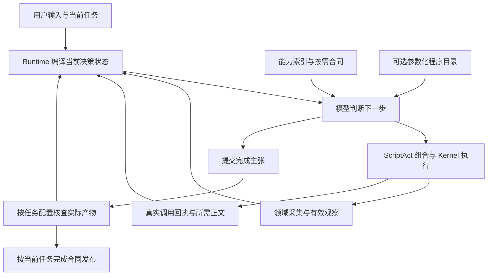

# ScriptAct 下一代优化设计方案

2026 年 10 月 1 日，10 月 3 日更新。本文保留本轮的设计依据；实际代码、提交、合同差量和最终验收以[交付报告](scriptact-next-generation-delivery.md)为准。上一代的证据见[实现与证据报告](scriptact-optimization-implementation.md)。

建议把优化目标定为：模型用更少的往返、上下文和重复生成，完成同等或更可靠的业务任务。ScriptAct 继续提供代码组合能力，Runtime 管理当前状态、材料与执行生命周期，领域能力承担它能保证的业务语义。

核心设计是把模型的工作集中在目标理解和业务判断上。已经确定的依赖步骤可以合并执行；需要根据实际结果改变方案时，再把结果交给模型。能力发现、当前状态重建、正文补齐和失败恢复都有明确的运行支持；它们的收益用完成整个任务所付出的代价判断。短任务保持直接组合，长期重复工作再逐步沉淀为可复用能力。

## 推荐落地版本

先交付一个可靠的业务闭环：**取得真实输入 → 执行一段有边界的业务脚本 → 获得足够的结果和诊断 → 修复具体问题 → 核查实际交付**。模型决定做什么和如何组合；运行系统承担已经可以确定的状态、容量、执行和恢复工作。第一版的目标是让这条路径容易走通。

### 1. 把三层责任固定下来

| 层 | 负责的决定与保证 | 当前落点 |
| --- | --- | --- |
| 模型与 ScriptAct | 解释目标、选择方案、组合临时逻辑、根据真实结果改变策略 | Agent 主循环、Script 编译与执行；短任务直接提交脚本 |
| Runtime | 编译当前工作集、选择实际发送材料、保留调用事实、管理容量和进程生命周期 | act/runtime、Context、Kernel；复用现有工作视图、journal、请求编译和完成回调 |
| 领域能力与宿主 | 输入身份、资源版本、批量事务、真实测试、产物提交和业务成功条件 | Project、Files、Shell 等所属单元；宿主装配实际可用端口与完成核查 |

脚本边界由依赖关系和模型判断需求决定。例如“应用一组已确定的编辑并运行相关测试”可以在同一脚本完成；测试结果需要分析时，结束执行并进入下一轮。独立读取可以批量并行；有依赖的步骤按顺序；一致性要求由所属领域的事务操作保证。任务可以依据真实反馈改变方案。

领域高阶操作的准入依据是稳定业务语义、事务保证或跨任务重复成本。例如批量编辑的版本前提与提交结果属于 Project；某题的一次性修复策略由模型组合。公开声明、效果和模板继续由所属 TS 操作接口生成。

业务意图在任务开始或要求变化时声明：要解决的问题、实际输入、交付对象和成功条件。随后由现有 Runtime 将这份任务材料与真实调用结果编译进每轮工作集。业务策略变化由模型决定，页码、结果曝光、进程所有权及容量核对由相应运行组件维护。

### 首版的一次完整任务

以修复两个关联文件的故障为例，推荐路径如下：

1. 宿主提供工作区、问题描述、可修改范围、保护范围及相关公开检查；模型可以通过普通能力访问这些输入。
2. 模型批量读取需要的源码，主动运行能复现问题的测试。脚本输出实际退出状态与必要诊断，原始结果保持可召回。
3. 模型根据诊断确定修改方案，将已确定的编辑、修改核对和相关测试组合执行。Project 提供对应事务与版本保证，Shell 保存真实执行终态。
4. 测试失败时，下一轮给出失败位置与原诊断、已经完成的修改及未知效果。模型按新事实调整方案，继续修复。
5. 模型申请完成，宿主核查当前产物、关联检查与交付要求；具体失败返回修复路径，通过后交付。

这条路径按实际依赖和结果展开，轮数随任务变化。现有 `execute`、journal、结果归档、工作视图与完成回调承担运行链；首版围绕这些入口交付可靠行为。

### 2. 每轮提供一份小型当前工作集

当前帧固定表达五类内容：当前目标与有效约束、可用能力和输入位置、已确认效果、失败或未知效果、下一项需要处理的材料或核查。沿用现有 frame、journal 与工作视图编译这些事实，材料的业务用途由模型或任务合同提供。用户纠正目标后，按最新目标重建；业务推测和计划保留模型来源。

长源码、历史日志与原始材料通过现有结果归档和读取入口提供。当前帧保留准确身份、版本、可见范围及缺口；稳定历史按已有冻结消息承载。优先呈现本轮改变决策的事实，例如失败断言、实际退出码、版本冲突和未完成写入。

容量由整个实际请求共同核对。先保留约束、失败、未知效果和任务必需材料，再分配普通正文。显式请求全文且实际容得下时直接送达；大材料给明确缺页和现有分页输入。分配规则首先采用确定性策略，常规回合沿用现有整理触发条件。

模型表达本次要判断的材料和范围，Runtime 返回可以直接使用的读取输入；领域负责原件身份与版本。当前帧的必要可见性与任务最终交付要求分别管理，按各自实际条件核查。

### 3. 把失败做成可以继续工作的反馈

恢复输入按实际调用记录组织：成功读取的原值入口、确认写入的提交回执、失败步骤的原诊断、效果未知步骤的核对入口。可选探测失败时，已经成功的必要读取仍可利用；未知写入先核对实际效果，再决定重试。

代码任务的最低闭环是：模型能主动执行公开测试，下一次实际请求带上失败退出码和必要诊断，模型编辑后能再次执行同一测试。Shell 的超时、取消、正常关闭和强制截止都由宿主管理所拥有的进程组；测试日志和终态保存为真实事实。任务无需通过额外的过程描述才能使用这些结果。

### 4. 按任务要求核查完成

任务开始时由宿主给出可访问输入、目标产物、保护范围、公开成功条件和交付对象。结束时通过现有 `ContextCompletionPort.verify` 核查实际产物；具体失败反馈给模型继续修复，无法核实的范围保留 unknown，修复受原任务预算约束。

普通代码维护任务主要检查问题解决、相关测试、保护范围和实际交付。需要全文审阅的任务再增加对应源版本的正文送达条件；摘要或文件交付按自身约定核查。材料读取、实际发送、业务检查和模型理解各自记录，完成条件由任务决定。

核查范围由任务与所属领域明确提供。Project 负责当前文件和写入前提，Shell 宿主负责真实测试与进程，任务宿主负责最终交付对象；Runtime 组织这些实际回执与反馈。领域失败、执行失败和无法判断分别表达，通用材料呈现只承诺自身能核实的范围。

完成发布沿用现有任务与目标身份核对及原子提交。用户在检查期间改变目标时，检查报告归属于当时对象，当前目标按新的要求继续。

### 5. 根据收益选择复用机制

| 机制 | 适合启用的条件 | 要支付的额外代价 |
| --- | --- | --- |
| 轻量索引与批量合同 | 同轮需要多个真实导出；共同规则可以合并送达 | 索引和声明占用，合同维护；同时观察是否减少模型往返 |
| 观察复用 | 有可靠变化代次、完整依赖覆盖，采集明显比探测贵 | probe、身份维护、失效与恢复 |
| 检查复用 | 成功检查的依赖可完整核对，重复检查昂贵 | 前后探测、范围登记、结果适用性核对 |
| 参数化程序 | 同一稳定逻辑确实反复执行，只改变参数 | 冷发布、发现、版本维护、源码归档及运行恢复 |

现有机制已经具备时，下一步先核实真实触发与净收益。第一版的功能出口是可靠任务闭环，后续分别扩大这些机制的适用场景。

### 实施顺序与验收

| 阶段 | 具体交付 | 进入下一阶段的条件 |
| --- | --- | --- |
| P0 真实闭环 | 明确任务合同；Project 与前台 Shell 的真实装配；失败日志送达；局部修复与再次测试；当前产物完成核查 | 冻结历史初态的真实故障可以由模型修复；全部原尝试、失败、未知与环境阻塞如实保留 |
| P1 减少常用往返 | 针对已发生的补读、重读、发现或状态误读，每轮修复一个通用机制；优先直接送达放得下的必要结果 | 独立任务完成率保持或提高，再证明整题时间改善；共同环境改动应用于两组 |
| P2 场景复用 | 在重复、长程或昂贵检查的任务中分别启用观察、检查或程序复用 | 失效正确，节省覆盖采集、探测、发布与恢复的全部开销，完整费用可判断 |

工作视图、批量合同、程序目录、观察与检查复用、E7 显式全文预算修正和真实任务闭环已提交主仓库 `09adc2e8`；协议恢复校准已提交 `b76fc7ef`。运行时继续使用既有任务、执行、归档与完成端口，各机制的启用条件和实际责任见[交付报告](scriptact-next-generation-delivery.md)。

本轮验收包含原 E8 的 24 次冻结对照和最终提交版本的六项维护任务回归，全部原尝试纳入报告。完成率、整题耗时和费用分别记录；本轮按实现、跑分、报告和本地提交收尾。

## 现有机制与后续扩展

现有工作视图、核查报告和协议恢复作为闭环底座。首版 P0 按上文的真实任务路径交付；下面列出遇到对应瓶颈时的扩展范围。每项以真实失败或成本事实为起点，单独决定本轮实现。

| 单元 | 输入与行为 | 所有者 | 交付验收 |
| --- | --- | --- | --- |
| 任务材料 | 任务开始时提供实际可访问输入、目标产物身份、保护范围、公开成功条件及交付对象；用户纠正后按当前目标重建 | 宿主任务集成，领域提供真实身份 | 模型的实际请求中包含这些条件；普通发现能找到初始材料；验收条件与公开要求一致 |
| 可行动的失败报告 | 核查按项返回 status、公开问题描述及实际产物身份；失败和未知项优先进入当前帧，长详情保留完整原报告及召回入口 | 领域核查器、宿主完成回调、Runtime 投影 | 一项失败能定位处理对象；预算裁剪保持真实计数和缺项；完整原报告能读取；业务未通过时继续修复 |
| 统一恢复与交付 | 普通请求和修复共用容量计量；成功调用、失败调用及未知效果分别呈现；按任务声明检查最终产物和所需材料交付 | Agent、Model、Runtime、对应领域 | 可容纳的恢复请求能执行，真实超窗准确处理；部分效果可核对；任务约定的产物与交付同时满足 |

这些扩展沿用现有 `ContextCompletionPort.verify`、调用 journal、`memory.read` 和 ScriptAct 执行链。任务确有约定正文缺口时，内部交付投影先做最小原型，以真实使用证据决定公开合同。新增模型操作继续从所属 TS 操作接口生成声明、效果和模板。

验收先检查闭环是否提高完成率，再比较整个任务耗时，最后比较完整费用。任务材料与发现环境的共同修正应用于所有对照组；宿主逐项反馈和 Runtime 投影分别消融。阶段出口是能够判断每项改动对整题的贡献，据此决定默认启用范围。

闭环通过后，第二阶段减少发现、补读和状态重建的往返：批量获取能力合同，直接提供放得下的必要正文，明确大材料的版本与剩余缺口。第三阶段再把稳定重复工作沉淀为领域高阶操作、参数化程序或检查复用，每种复用分别证明其节省覆盖采集、探测和维护成本。

## 后续机制的职责与边界

ScriptAct 继续作为组合语言；领域能力、材料交付、恢复和完成核查各有明确所有者。下面说明后续扩展的五项设计，适用范围由实际任务及机制触发决定。

| 决策 | 具体设计 | 首个交付范围 |
| --- | --- | --- |
| 模型每轮面对当前工作集 | 最新帧包含当前目标、有效约束、已确认效果、未知效果、必需材料缺口和下一项待处理事实；计划与解释注明来源 | 复用现有当前工作视图，补齐材料缺口和恢复输入；量测它对业务判断和整题轮次的影响 |
| 材料有独立生命周期 | 区分源已读取、完整值已归档、正文已送达及当前窗口仍可用；以领域提供的产物身份和精确版本关联覆盖 | 先在 Runtime 的现有交付链旁提供有界只读投影，供任务验收查询；由领域把业务产物映射到可信源 |
| 大材料按缺口推进 | 放得下的必要正文直接发送；放不下时给缺失范围与可照抄的分页输入，只有实际送达后才推进覆盖 | 在现有 output、租约和 memory.read 上实现预算与缺口呈现，保留最终 Provider 容量核对 |
| 失败以实际调用恢复 | 同一脚本的成功、失败、未收束与效果未知分别呈现；模型可取原 journal 值继续处理 | 改善既有恢复索引、召回输入和领域模板；协议修复沿用普通请求的完整计量规则 |
| 完成按任务约定核查 | 宿主先声明业务产物、交付对象和范围；核查失败反馈具体缺项，模型继续修复 | 复用 ContextCompletionPort.verify；仅对约定需要的材料检查实际送达，按任务分别允许摘要、引用或完整正文 |

材料投影先保持内部概念：产物身份、精确版本、来源回执、已送达范围、尚缺范围及现有读取输入。具体公共类型在原型证明必要后进入所属 TS 合同。Runtime 维护真实交付事实，领域负责版本与业务含义，Context 消费中立核查结果；实现时遵循这条依赖方向。

“模型取得完整正文”和“用户取得最终文件”是两种交付范围。普通产物任务可以交付文件及所需核查；任务明确要求模型检查完整内容或用户收到全文时，才采用相应正文条件。条件在任务开始时表达，收尾反馈只报告约定中的缺项。

### 一次任务怎样运行

以一个公开设计示例说明：任务要求修改三个文件，并核对其中一份大文档的完整最终内容。模型完成编辑后，领域返回实际提交范围及版本；Runtime 根据任务条件安排当前材料。两个小文件可以完整发送，大文档按剩余容量发送整页，并显示已经送达和仍缺的范围。模型处理当前页或直接采用现有读取输入取得缺页。当前版本内容全部送达且业务检查通过后，按已有完成合同收尾。

如果该文档中途改变，领域版本核对使旧覆盖转为历史事实，重新核对受影响材料。如果同一稳定版本重新观察，只因产生新的归档引用就重复整份正文，会浪费上下文；覆盖应关联可信产物版本。如果可选目录探测失败而三个文件读取已成功，恢复帧给出这些调用的原值入口和失败项，模型据此决定继续路径。

材料所占份额采用动态分配：先保留当前约束、失败、未知效果与必需事实，再根据当前缺口分配正文；稳定历史正文可以继续由实际选入的历史承载。最终由 ProviderRequestCompiler 核对完整请求。每次补页的读取、请求、等待和核查都计入任务总账，方案的价值必须覆盖这些新增开销。

### 落地顺序与阶段出口

| 顺序 | 本轮实现单元 | 本轮必须证明的行为 | 进入下一步的依据 |
| --- | --- | --- | --- |
| A 统一恢复准入 | Agent 的普通请求和协议修复共用文本校准、输出预留及非文本计量规则 | 可容纳的修复请求能继续；真实超窗、取消及未通过协议的响应保持准确处理 | E4 全 36 次已结束，两次真实协议修复由校准准入并执行；对应业务均未通过。整体收益需结合任务输入、发现环境与完整时费审计判断 |
| B 明确任务合同与失败定位 | 将产物身份、公开成功条件和可访问输入作为任务材料；领域返回具体公开规则、问题类别及实际位置；Runtime 优先呈现失败和未知项 | 模型知道修改与交付对象；完成失败能定位问题并继续修复，完整原报告仍可召回 | E6 的 24 次真实原尝试两组各严格通过 9/12，增强诊断实际触发为零，候选总 primary 时间慢 17.26%，未证明收益；E7 转向已有明确全文请求的预算估算，先核查真实资料送达，再以新任务验证 |
| C 接通任务交付核查 | Runtime 有界交付查询、领域产物映射、宿主配置的完成回调 | 业务正确但约定正文缺失时能反馈精确缺项；合法摘要和引用任务照约定完成 | 实际请求证明、版本与任务边界回归通过，再冻结新的独立任务验证恢复到完整交付 |
| D 减少补读与重做 | 按真实共享预算分配正文、完整页及缺口提示；原 journal 召回与可选步骤模板 | 放得下的必要正文直接送达，漏页可定位，已成功读取可以利用 | E7 全 24 次结束，两组业务各 12/12，候选原 primary 总时间低 8.19%、请求 112→106；合同省补读的因果证据仍未知，完整费用未知，后续扩展到独立真实工作流 |
| E 精简发现与当前状态 | 巩固已有短索引、批量合同和当前状态，按实际高频路径调整 | 模型能快速找到真实能力，用户纠正及任务切换后仍作出准确行动 | 发现调用减少需兑现为整题收益；保留各类别退化 |
| F 扩大场景复用 | 按场景分别接入纯派生快照、成功检查复用及参数化程序 | 稳定重复工作减少，变化后准确失效 | 净节省覆盖发布、采集、探测、归档及维护开销，再扩大启用范围 |

任务合同和失败反馈是工作集的基础。产物身份若只存在于宿主验收清单，模型不能据此判断自己改的是不是交付文件；领域核查若只返回一个 boolean 或泛化原因，完整存储这句话仍不足以支持修复。宿主应返回已有 ContextVerificationCheck 可承载的安全 label / status / artifact 身份与实际内容指纹，Runtime 在同一预算中先展示失败、再展示未知项；原报告顺序、原项 index、任务绑定和当前适用性保持可核对。报告引用沿现有 memory.read 读取，隐藏测试和参考答案保持独立。

每步只改变可独立归因的机制。源先冻结，再生成尚未暴露的新任务；已用于定位的任务保留为开发回归。推广顺序固定为完成率、完成时间、完整费用。模块所有权、真实声明、模板和验收承诺随所属实现同步交付。

## 设计依据与目标

上一代独立小任务出现了提速，也出现了退化：最终候选的一项新任务两版均正确，耗时从 73.96 秒增至 135.02 秒，模型请求从 5 次增至 8 次，参考费用从 0.269 美元增至 0.752 美元。追踪中额外轮次涉及能力发现、模板和正文补齐。这是一个定位线索，尚不足以说明所有任务的瓶颈都相同。

当前主对照的 12 类任务、每版 3 次重复已全部运行，两版业务与保护字节核查各为 36 / 36。候选的合同查询从 163 次降到 45 次，但全部尝试完成时间从 4215.99 秒增加到 4462.88 秒，增加约 5.86%，模型请求仍为 278 次。原运行快照的完整费用未知任务为 6 → 14；一项迟到用量在权威台账收束后为 6 → 13，完整费用改善仍不能判断。全文交付的原评分和独立补充复核分别记录。

同源状态消融已经结束：两组业务产物均为 3 / 3，独立严格正文交付为完整状态组 3 / 3、预算组 1 / 3。预算组一项完整 JSON 容器属于原评分遗漏，另外两项确实仅交付引用或摘要。三次随机重复用于暴露问题，尚不足以认定每项缺口都由状态预算造成。

因此，当前实施重点放在必要正文交付和失败恢复这条常用路径。发现成本的下降值得保留和继续核查，其净收益需要在整题结果中兑现；快照、程序目录和检查复用按实际触发与净收益决定适用场景。

下一代采用下面五项设计决定：

| 设计决定 | 具体职责与交付 | 要证明的效果 |
| --- | --- | --- |
| 当前状态与正文分开管理 | Runtime 每帧给出小型当前状态；Script 按实际编码交付所需正文，超窗原文保留完整召回路径 | 状态易于理解，模型需要的材料真正可见 |
| 失败按真实调用恢复 | 保留已成功调用与失败、未知效果的原回执；可选探测与必要步骤分别处理 | 减少重读和整段重做，部分效果可准确处理 |
| 能力按业务粒度提供 | 短索引和合并合同支持快速开始；领域操作承担批量、事务和一致性；临时策略由脚本组合 | 发现往返、胶水代码及业务错误减少 |
| 复用按场景证明净收益 | 稳定程序、纯快照派生与成功检查分别核对适用范围，计入发布、采集、探测和恢复成本 | 重复工作减少，变化后的行为仍正确 |
| 质量和代价进入统一验收 | 业务产物、所需正文交付与当前核查范围分别记录；整题计量包含失败和重试 | 默认策略依据任务完成率、时间与完整费用选择 |

整题耗时包含模型等待与生成、领域操作、观察、核查、修复和 Runtime 开销。字符数、调用数和缓存命中用于解释原因；默认策略根据正确率、端到端耗时和完整费用决定。

迭代优先级按用户要求固定：首先提高任务完成率，其次节约完成时间，在这两项得到保证后优化费用。任何倒退或未触发、无收益的机制都回到具体失败与成本事实定位，修复一般原因，再进行回归和新的独立验证。

## 整体结构与职责



模型决定目标解释、业务策略、材料选择及异常恢复。脚本承载临时组合、计算、并行和条件分支。领域能力提供事务、版本前提、产物解析等可靠语义。Runtime 维护身份、当前状态、权限、实际回执和生命周期。

短任务可以直接提交脚本。批量发现、程序发布和检查复用在适合的任务中使用，运行主链保持一致。目录、名称和版本是定位信息；实际正文、当前授权及真实执行结果分别由自己的链路负责。

## 默认任务路径与首批交付

默认路径是：找到所需能力与声明 → 读取当前材料 → 提交业务脚本 → 查看真实结果 → 核查交付。每一轮为模型提供作出下一步业务判断所需的事实，确定的步骤合并执行；Runtime 提供足够的状态、材料与失败定位，减少为了管理执行过程而增加的轮次。

各能力的交付范围与推广依据如下，实施按上文 A–F 推进。每项单独验证，防止多种机制一起启用后无法判断代价来自哪里。

| 能力范围 | 具体交付 | 对任务的实际影响 | 推广依据 |
| --- | --- | --- | --- |
| 必要正文交付 | 按实际发送编码计算整个输出预算；完整短值直接交付；required/high 优先；超窗口原文保留准确分页位置 | 放得下的正文在下一轮直接可见，确实放不下的材料可以完整召回 | 正确全文交付保持；补齐正文的额外请求和整题耗时减少 |
| 失败后的恢复入口 | 失败回执清楚列出已成功调用、失败调用、未知效果及其原 journal 位置；模板将独立可选探测与必要读取分开处理 | 一项可选探测失败时，模型能取得已完成的必要读取，准确决定重试范围 | 读取与外部效果不丢失；重复读取和恢复轮次减少；未知写入仍需核对 |
| 能力发现与当前状态 | 使用真实导出短索引、一次批量合同查询和可独立理解的最新状态；正文版本与来源可核对 | 模型更快开始业务工作，任务切换和用户纠正后仍能准确行动 | 发现轮次、未知导出错误及状态误读减少；整题质量和时间通过对照 |
| 场景复用 | 分别启用领域快照、逐项核查或命名程序；登记、探测、归档和恢复全部计入 | 稳定重复任务减少重复生成或执行 | 该场景的端到端节省覆盖机制自身开销，变化场景仍正确失效 |

第一项的文本编码修复已有合成回归和隔离构建证据，E3b 的 36 次真实模型对照已结束；原冻结评分为基线 15 / 18、候选 13 / 18，独立统一补充复核为 16 / 18、13 / 18。174 个精确有限预算视图回放仅有一项基线视图的反事实完整准入改善，候选实际改善为零；另外 27 项不能精确回放、625 项未持久记录有限预算，分别保留。随后 E4 已完成协议恢复计量修复的 36 次真实验证，两次真实协议修复获得准入并执行，对应整题均未通过；整题对照还存在任务身份与发现环境混杂。当前先验证明确任务合同、逐项失败反馈及失败优先投影，再接通任务约定的送达核查、共享预算和补读。第二项使用既有调用索引和原 journal 召回，重点核对材料可用性、可照抄的召回入参和模板能否减少恢复轮次。第三、四项的实现状态与模型结果见[实现与证据](scriptact-next-generation-implementation.md)，推广选择继续由任务完成率、完成时间和完整费用决定。

业务脚本中的依赖步骤按顺序执行；独立的读取可以并行，并分别处理结果。基础能力提供组合空间，领域高阶操作承担事务、版本前提和一致性保证；这些语义进入正式 TS 合同与模板，模型可以据此选择正确的批量方式。

## 失败恢复以真实调用为单位

脚本可能先完成必要读取，再因一项可选能力不可用而终止。当前下一代恢复设计要让模型直接取得这次执行已经产生的有效结果，明确知道仍需处理哪一步。

| 执行事实 | 恢复时交付 | 下一步处理 |
| --- | --- | --- |
| 已成功的读取 | 原调用身份、所读范围、结果原文位置和当前所需正文 | 直接利用已取得材料；需要当前版本时按领域合同重新读取 |
| 已确认的写入 | 实际提交回执、已影响范围、所属事务或调用身份 | 在已确认效果上继续，按领域支持撤销或补偿 |
| 已确认失败 | 失败调用、错误码、依赖关系和已产生的部分结果 | 调整失败步骤或处理依赖步骤 |
| 效果未知 | 原调用与执行身份、当时原因、后续原 journal 查询位置 | 先查询或核对实际效果，再决定重试 |

恢复统一使用既有 `progress.feedback.recovery.index` 和 `memory.read({ ref, invocation, pointer })`。前者定位该失败执行的真实调用索引；后者按索引中的调用身份读取原 journal 回执，可用 `/value` 定位返回值，并按现有分页规则取得所需正文。未收束的调用报告不可用，后续原 journal 得到真实回执后才能召回。任务、执行和当前授权仍由既有链路核对。

真实失败链中，8 个失败帧都已呈现成功调用身份及恢复索引，却没有发送该读取的完整原值，后续都重新读取来源；36 次候选尝试的 144 次 memory.read 中没有一次使用 invocation 选择器。因此，下一步重点是使现有恢复入口容易使用，并验证取得原 journal 值是否比重读来源更合算。索引存在本身不足以证明恢复已经有效。

第一阶段改善可照抄的召回输入、必要正文交付和领域模板，使模型清楚看到哪些已成功结果可以直接利用。具体呈现改动根据已暴露任务的真实失败与补读链确定；Runtime 陈述真实执行事实，模型决定继续、换路或终止。独立可选操作使用分别处理结果的写法；依赖操作保持顺序，领域批量事务继续作为一项正式操作使用。验收覆盖读取成功后可选探测失败、写入部分提交、取消及迟到结果，比较重复读取、恢复轮次和整个任务耗时。读取原 journal 仍可能需要一次补读，不能预先承诺每次失败都节省一轮。

协议修复同样属于这条恢复主链。普通请求与修复请求使用同一供应商计量、已学习文本校准、输出预留和图片 / 不透明内容计量规则，重新封存实际修复请求。真实供应商超窗仍按既有容量恢复重建；协议未通过时任何脚本都不执行。E4 的隔离候选已修复修复分支遗漏文本校准的通用差异，并通过真实请求验证其准入作用。整题质量收益仍需按失败根因、任务合同和发现环境分别判断，后续改动继续独立验证。

## 任务质量同时覆盖产物与交付

验收按任务要求分别检查业务产物正确性和材料交付：业务核查回答实际文件、数据或远端效果是否满足目标；交付核查回答模型或用户是否收到要求的正文及其准确范围。引用、摘要与完整正文各自表达真实覆盖。

任务配置的领域验收器负责它能核查的条件；公开要求允许不同正确实现，测试条件不能额外限制未约定的实现方式。核查报告注明范围、时刻和未知项，按既有任务完成合同发布结果。新鲜度、写入前提和事务保证继续由相关领域合同负责。

当任务明确要求最终正文，宿主将交付条件纳入既有 ContextCompletionPort.verify：业务检查和交付检查分别报告；真实正文缺失时返回具体缺项及 repair，让模型继续补齐。宿主通过 RuntimeTrace 核对已接受请求的全文交付记录、封存请求摘要与当前领域产物，按任务把可信源关联到实际交付对象。真实 Runtime / Shell 的 task-loop 回归已验证这一接线。该策略仅作用于任务约定的材料与范围，允许摘要或引用的任务按其自身交付要求验收；通用 Runtime 不推断正文语义或业务正确性。

大材料应按同一源版本记录已送达范围与剩余缺口，下一步直接指向所缺正文。真正读取完整值、调用 output 和实际发送完整页是三件不同的事；当前页未送达时继续补齐它，不能把已归档页或旧版本全文算入当前覆盖。正文份额、已在历史中的页和仍驻留的结果租约共同进入预算与生命周期管理，减少让模型反复读取整页包装、猜测缺口或手工重建进度。这部分先以任务配置和既有送达记录实现最小路径，再用实际模型请求验证是否减少漏页与往返。

模型处理原值、结构化对象或无损字符串容器时，交付判断应保持一致。证明来自权威源回执、准确归档与实际发送内容；需要全文的代码和文本保留完整范围及精确内容，遵循来源操作的编码与换行合同；业务 JSON 则按任务约定核对结构与值。

## 能力发现采用三层交付

第一层常驻轻量索引：模块名、一句话用途、真实值导出名与合同正文版本。模型可以直接找到可 import 的名字，避免先查询操作名，再猜测导出名。

索引也受上下文预算约束。能力较少时直接列全；能力增多时按宿主装配的职责范围展示短索引，明确省略数量和目录入口。完整目录继续分页读取，避免模块规模增长后索引本身成为主要开销。

第二层按需要返回正式声明。一个请求可以指定同模块的多个导出，所需依赖类型与模块共同规则只返回一次。第三层提供用法模板，指定导出时由调用方显式请求，完整模块查询保留整份材料的用法。

拟议调用形状：

```js
const contract = await modules.describe({
  module: 'velaros:project',
  exports: ['read', 'search', 'edit'],
  template: false,
});
output(contract.declarations, { type: 'code' });
```

`contentRevision` 覆盖声明与模板原文。它与模块挂载身份、schema 版本分开：文档变化需要新的正文版本，实例变化也需要当前绑定身份。已有同版本正文可以复用；共同路径规则等约束在任何相关导出切片中均能取得。

验收同时测量真实发现轮次、声明和模板交付量、未知导出错误及业务任务正确率。按导出裁剪不能丢掉公共约束，也不能导致模型为每个小操作额外查询一轮。

## 当前状态按决策优先级编译

每帧继续给出可独立理解的当前状态。Runtime 从真实记录编译，状态中的模型笔记保留其解释属性，用户原文与实际回执保留来源。

| 优先级 | 内容 | 容量处理 |
| --- | --- | --- |
| 必须保留 | 当前目标与有效约束、待核对输入、失败与未知效果、部分提交、必需材料缺口 | 完整呈现；必要状态放不下时走明确容量恢复 |
| 当前行动相关 | 活动作业身份、当前计划、观察状态、核查范围、待处理结果 | 保留当前集合与关键事实，避免从历史补丁重建 |
| 可召回细节 | 长证据正文、完整读取目录、源码差量、低价值重复元数据 | 按预算展示片段或引用，保留原文位置与省略范围 |

预算覆盖当前状态和正文所在的实际请求。展示压缩后仍能通过现有 `memory.read` 召回完整归档；条目身份和有序集合保持准确。当前约束、失败及材料缺口不得因摘要而变成成功或已处理。

实现先采用确定性选择规则，减少正常回合对额外整理模型的依赖。状态预算是软配额，实际 Provider 请求编译继续负责最终容量核对。若必要状态本身超过配额，明确报告超载。

验收关注最新帧的行动判断、约束撤销与替换、失败恢复、任务切换和精确召回。模型已看到完整正文的证明继续来自实际发送内容，引用或摘要不替代正文交付。

## 稳定逻辑按复用范围沉淀

能力保持三种粒度：基础操作供临时组合；领域高阶操作承担事务和一致性语义；参数化程序承载反复出现的组合逻辑。

参数化程序目录提供 `publish / list / describe`。程序有稳定名称、不可变 `sourceRef`、用途、参数说明和发布时的真实导入依赖。发布执行语法和依赖检查并归档，具体运行继续使用现有 `execute({ sourceRef, input, blobs })`。同名更新携带 `baseRevision`，通过 CAS 产生新版本；`contentRevision` 标识源码原文。当前可访问的旧引用仍定位原版本。

第一阶段采用当前任务可见、当前授权范围的目录。任务切换或授权重置后，跨任务复用按已有来源授权规则接入。程序执行时仍按当前权限核对，描述文本由作者提供，业务适用性需要判断。一次性脚本沿用直接执行；反复改变参数而逻辑稳定的任务才值得发布。

跨任务反复出现、需要领域保证的组合，经实测后进入所属能力单元的正式操作。跨文件系统、服务和 UI 的组合保留各步真实回执与部分效果，恢复时按领域可支持的补偿或继续方式处理。

验收比较重复任务的代码生成量、执行与恢复成本，并记录发布、发现及版本维护的额外代价。程序复用的收益应覆盖这些代价。

## 观察分开处理真实采集与纯派生

观察成本按层处理：领域先取得真实源快照，再做纯转换与展示。模型需要持续关注什么，按当前阶段配置；阶段结束通过现有 clear 或计划更新退役观察。

首个领域计划为 Project 文件快照：指定路径、行范围、输出 key 和用途，可选文本或 JSON Pointer 投影。每轮真实采集走 Project 与 Kernel 的现有授权和回执链。完整捕获值相同时，可以复用纯派生结果，保留原结果身份和派生时刻，同时记录本轮采集时刻及回执。捕获值包含领域返回的版本；恢复相同字节但版本不同，也会保守地重新派生。

这种同值比较表示当前捕获值一致，不证明期间没有变化。它主要减少纯转换及隔离程序运行，文件读取仍真实发生。采集和前后核对的额外读取都进入账。取消及时退出，尚未收束的成本保持未知；随后实际收束的诊断由原调用 journal 保存，追踪按该调用身份读取，历史归档保留当时事实。

具有可靠变化代次、完整依赖覆盖和生命周期身份的领域，可以接入既有可信 probe，从而连采集一起复用。未知覆盖、变化、权限范围重绑、重启、采集失败或显式 refresh 时重新采集。

选择观察方式时比较探测、采集和派生的成本。便宜读取配昂贵探测时，继续实际读取可能更合适。目录只列已由领域支持的计划；任意脚本仍依赖它自身可被可靠覆盖的条件。

验收分开报告真实读取次数、捕获材料量、派生执行次数、探测耗时和整题收益。当前值相等与可靠变化代次分别测试，变化后恢复原值、任务切换和权限重置也要覆盖。

## 收尾核查按检查复用

核查继续由任务配置的领域验收器负责。宿主可以将验收拆成有明确依赖范围的检查：检查身份、验收范围、核查器版本、产物集合及可信版本探测。旧核查器保持可用。

只有完整通过且全部依赖仍匹配的检查允许复用。例如第一次收尾中 A、B 两项通过，C 失败；修复 C 后，A、B 的依赖未变就复用原证明，C 实际重跑。探测未知或依赖改变的项重新核查。

报告保留原检查时刻、原范围和证据。当前适用性另行表达为 current、historical 或 unknown，防止历史 passed 被解释成当前产物仍满足条件。检查开始与结束都核对依赖，完成发布仍使用当前任务及目标身份的原子提交。

当前帧的原报告计数与本次适用性计数分别呈现；检查详情全部超出预算时，historical 与 unknown 计数仍必须可见。摘要裁剪不能把已失效的证明显示成当前通过。

复用只服务已登记检查，核查器持有真实探测责任。每项探测、执行、失败、取消及迟到结果记录到所属任务，费用按 charge ID 去重；无法取得费用时保留未知覆盖。当前帧读取报告适用性也会产生实际 probe，其耗时和费用一并计入净收益。

验收包括修复后局部复用、产物增删、依赖改变又恢复、核查器升级、核查中变更、取消及目标替换。成功缓存带来的少执行必须伴随真实适用性核对。

## 计量与评测进入同一交付流程

每次模型请求记录身份、耗时、结束状态和供应商实际报告的用量。没有终态用量的请求标记 unknown，取消与重试仍计入次数和耗时。供应商能力通过明确配置与兼容核验决定，失败预检单独保留。

宿主执行活动有独立会话分页，覆盖首个请求之前及取消后没有下一请求的执行。调用方取消结果保持当时事实，实际读取迟到的 journal 回执仍按原 execution ID 可见。目录快照版本只描述目录，journal 收束需要重新读取原活动页，消费方按调用身份去重。

任务总账同时包含主模型、整理、搜索、子任务、观察、probe、领域核查和外部收费。供应商 token 乘参考单价的费用与实际账单分开表示；相同收费事实只计算一次。

开发回归用于定位原因。独立验证先冻结未暴露的任务、质量判据、版本和配置，再运行对照；保留全部失败、未知用量与退化。任务覆盖短读写、多步修改、大材料计算、持续观察、局部修复和长程输入变更。

建议首轮使用至少 12 项新任务，每版每项重复 3 次，交替运行顺序；该规模用于发现趋势和退化，推广默认策略还需扩大样本。单项消融区分发现、状态编译、观察和核查各自贡献，机制未触发的任务注明原因。

默认推广首先要求既有正确性边界通过，独立集完成率保持或提高；再比较整题耗时，保留各类别及失败尾部的倒退。在前两项得到保证后评价费用改善，改善应覆盖多个任务类别。耗时降低 15%、费用降低 20% 是首轮设计目标，不是当前已证实的收益。

## 实施顺序与所有权

### 当前候选与后续决策

E6 可行动诊断的 24 次真实对照两组各业务通过 12 / 12、严格通过 9 / 12，诊断触发为零，候选总 primary 时间慢 17.26%。该结果支持继续定位实际常用路径；现有证据尚未证明诊断能改善整题质量或速度。

E7 当前只改变显式 full、未指定数值 maxChars 的实际需求估算。Script 先按所选内容的真实编码计算需求，既有结果池负责分配，Runtime 与 Provider 保留原容量核对。公开 Runtime / SDK 补读案例由两轮降为一轮；容量不足、数值上限、configure 与 required-auto 边界保持。源码、工具和审计规则先冻结，独立作者再生成 6 题；24 次正式模型对照已结束。两组业务各 12/12，严格交付为基线 10 次通过 / 2 次未知、候选 12 次通过；候选总 primary 时间低 8.19%，12 对中 7 对更快、5 对更慢。该观测尚不能全部归因于全文需求修正，完整费用未知。

| 需要回答的问题 | 固定测量 | 下一设计决策 |
| --- | --- | --- |
| 模型是否自然使用这条路径 | 全部原尝试中的 requested / effective full 资格，真实 output 及同源 recall | 无触发时定位实际材料获取路径，再选择下一机制；调用存在不能代替全文实际送达 |
| 正文调度是否减少往返 | 同源同版本材料首次进入真实 accepted 请求的位置、whole-page 补读及其真实等待 | 正文提前送达而整题轮次不变时，检查业务动作组合与后续判断依赖；先定位额外轮次再修改所属实现 |
| 是否改善任务质量和时间 | 全部原尝试的业务质量、严格交付、未知项、primary / process / totalFlow 时间与类别倒退 | 完成率保持或提高，再比较整题时间；原失败与未知项保留，效果不足时继续一般原因修复 |
| 是否值得成为默认行为 | 完整费用覆盖、全部请求状态、实现边界及不同规模任务表现 | 在质量和时间得到保证后判断费用；参考报价和实际账单分别表达，完整未知时保持未知 |

本轮没有把模型理解、当前窗口驻留或因果节省从“已送达”推导出来。运行、评分与诊断工具在新题生成前闭封，原模型尝试按计划一次执行。后续材料版本映射、缺页推进和完成核查仍按 P0 分步实施，每次先证明真实问题与触发，再冻结新的独立验证。

资料调度、任务闭环和领域诊断分别验收。资料提前送达之后，模型仍负责正确使用它；任务约定的当前产物若确有交付缺口，再接通领域版本、Runtime 实际曝光与既有完成回调；公开规则确有无法定位的业务失败，再增强所属领域诊断。每次选择一个已有真实触发依据的机制，观察它是否减少下一步的补读、重做或失败恢复，而后判断整题净收益。

### 后续独立任务的范围

当前独立文件、代码与结构化内容任务可以验证资料调度和往返成本。E6 两组业务各 12 / 12，提示这一范围可能出现质量天花板；这类结果对生产工作流完成能力的代表性有限。下一套验证从冻结仓库和已装配领域能力中的真实维护需求独立选题，以实际业务约定确定成功条件。

| 任务类别 | 要覆盖的工作过程 | 完成核查 |
| --- | --- | --- |
| 真实仓库维护 | 跨模块修复、既有 WIP 下的限定变更、真实失败测试与构建 | 原业务问题解决，关联检查通过，保护范围保持 |
| 异步执行与恢复 | 真实可复现的部分成功、长进程中断或版本变化 | 已确认效果可继续使用，未知效果先核对，原目标最终完成 |
| 材料到产物的交接 | 读取业务材料、生成或更新最终产物、按实际需要交付 | 领域语义正确，任务约定的文件、摘要、引用或正文交付满足 |

独立作者冻结初态、成功条件与保护范围，模型自行选择能力和恢复路线。难度校准使用独立试题，正式留出题保持未暴露；已用于诊断的任务进入开发回归。各类别分别报告整题完成率、时间、完整费用与未知项，再决定哪些行为可以推广到相应工作流。E7 当前任务、源码、评分和运行配置继续按原冻结协议执行。

当前评估入口实际挂载 Project 的 read / list / search / snapshot / edit / inspect / undo 及标准 System 工作记忆、目录、程序与任务操作。构建测试只在 ContextCompletionPort.verify 的宿主完成验收中运行，模型没有主动执行 CI 的入口。下一批可直接覆盖真实仓库切片的跨文件维护、已有故障日志与完成反馈驱动修复、配置和迁移材料交接；这些任务的公开要求应与已挂载能力一致。

主动构建测试和真正后台作业另设能力装配阶段：先接入现有 createShellCapabilityModule、ShellSpacePort / ShellHostPort，核对 runCommand、listBackgroundTasks、terminateBackgroundTask、refreshShellEnvironment 与观察接口的实际宿主行为；共同装配及边界检查冻结后，再生成相应留出任务。源码中存在能力与本次入口已经装配能力分别报告，宿主验收不计作模型自己执行命令。

E8 共同装配及公共边界核查已闭封，进入独立历史选题与真实故障 / 修复复现。复用 E7 两份冻结源码，真实维护问题由独立作者在公共工具封存后选择；模型可以主动运行已有测试，依据实际日志修复并再次运行。主完成条件为真实问题与测试通过、保护范围保持、任务完成及实际公开输入绑定；各题所需交付按业务约定核查。命令进程需绑定独占工作目录、有界运行与后代回收，私人作者资料、验收答案及其他运行产物不可读取，环境不继承模型服务凭据。宿主已有的 partial confinement 如实报告，实际可用边界通过公开命令验证。

该共同环境与任务合同应用于两组，比较的产品变量仍为 E7 的全文需求修正。计划 24 次原尝试，12 个配对采用 6 次 AB、6 次 BA，第二次重复反转第一次顺序。全部原尝试、失败与未知项保留；这些真实工作流结果将决定该修正的适用范围及下一项需要解决的问题。当前公共准备阶段尚未形成新的模型收益证据。

| 阶段 | 具体交付 | 所有者 | 阶段出口 |
| --- | --- | --- | --- |
| P0 真实任务闭环 | 公开任务合同；真实 Project / 前台 Shell；测试失败反馈、编辑与再次测试；当前产物完成核查；有界执行与进程回收 | act/runtime、Context、对应领域、宿主集成 | 实际任务可执行、失败可修复、完成可核验；独立原尝试完整保留 |
| P1 按真实瓶颈减少往返 | 选择实际发生的发现、状态误读、正文补齐或失败重读；分别改善批量合同、共享预算、准确分页或原 journal 恢复入口 | Agent、Model、Script、Kernel、act/system、act/runtime、对应领域 | 实际完成率保持或提高；该机制触发，整题时间改善；公开合同与真实效果边界保持 |
| P2 验证场景复用 | Project 纯快照计划；检查级复用；可选命名程序目录与领域高阶组合 | Project、Context、act/system、act/runtime、对应领域 | 变化时正确失效；发布、探测、采集和恢复的代价被实测节省覆盖 |
| 全阶段计量 | 请求、领域活动、核查、失败、取消与迟到结果的统一记录 | Agent、Model、Kernel、act/runtime、评测链 | 全部尝试与已知、未知费用可追踪，各机制贡献能够独立判断 |
| 推广验证 | 冻结独立集、多次配对、消融及完整证据报告 | 评测链及独立复核 | 决定哪些默认启用、哪些保持场景配置 |

模型操作仍从所属 TS 接口生成，效果、发现内容和模板同步维护。公开合同变化同步 README、invariants、API 基线和差量报告；各阶段完成所属包检查、生成一致性及模块所有权验收。

先解决常用任务路径上的正文交付与恢复，巩固轻量发现和当前状态，再按证据扩大复用。每轮冻结候选和新验证任务，上一轮暴露的任务用于诊断与回归。

相关依据：[代码面设计](script-design.md)、[运行主链](../architecture/platform-runtime.md)、[上下文管理](../architecture/context-management.md)、[ADR 0026](../decisions/0026-scriptact-current-state-and-verification.md)、[验收口径](scriptact-acceptance-criteria.md)。
